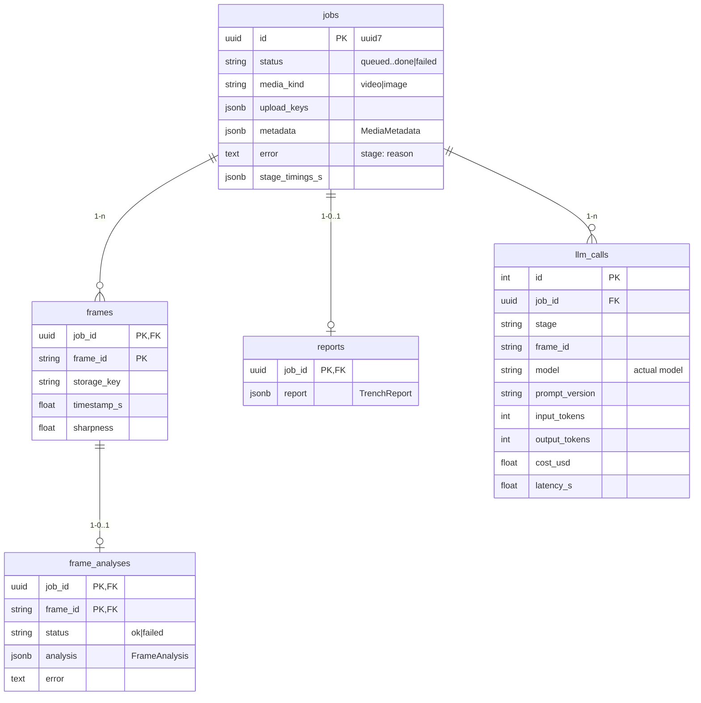

# Trench Report Agent

Upload a video or photos of an open utility trench and get back a structured documentation
report: which utilities are visible (gas, water, wastewater, district heating, power,
telecom), their material, their size when a scale reference allows it, and how confident the
system is. Lines the system is unsure about are flagged for human review, and the report
explains why. An evaluation on expert-labelled 3D trench data measures how often it is right,
and where it is not.

> Semantic extraction from 2D images only, no 3D reconstruction or survey-grade geometry.

## Results

Frame-mode evaluation on [OpenTrench3D](https://github.com/SimonBuusJensen/OpenTrench3D):
photogrammetric point clouds of Danish trenches with per-point utility labels, rendered to
images. The truth comes from the labels, never from a model. Test split: 45 views from 15 point
clouds in 5 areas that were not used for anything else. Prompt `v1`, unchanged since before the
first run. 95 % Wilson intervals in brackets.

| | Claude Sonnet 5.5 | Claude Opus 5.5 |
|---|---|---|
| Area's utility visible, model named its type | 32/43 = 74 % [60–85 %] | 33/43 = 77 % [62–87 %] |
| … utility covers ≥ 1 % of the image | 24/25 = 96 % | 24/25 = 96 % |
| … utility covers < 1 % of the image | 8/18 = 44 % | 9/18 = 50 % |
| Sizes reported without a scale reference | 0 | 0 |
| Lines of a type other than the area's that passed unflagged | 0 of 8 | 0 of 10 |
| Lines flagged for review | 80 % | 87 % |
| Cost / median latency per image | $0.010 / 5 s | $0.034 / 13 s |

What this means:

- **Large, typical utilities are found almost always; thin, half-hidden ones about half the
  time.** District heating (paired black pre-insulated pipes) was found in 9 of 9 views.
  Water mains that are a sliver of the image behind shoring are the weak spot.
- **Opus is not better than Sonnet for this task.** It costs 3.5× more and takes 2.6× longer
  for a difference of one view, well inside the noise. Sonnet is the default.
- **The system does not invent numbers.** No call, across 108, reported a diameter or depth
  without a scale reference.
- **Its caution is too blunt to triage.** Colour-only evidence is capped at confidence 0.6,
  and 0.6 triggers review, so 80–87 % of lines are flagged. Every line of a type other than the
  area's was among them.
- **What it cannot show yet:** type accuracy and calibration per line. Every test view also
  contains utilities whose type the data does not label, so a "gas" call on a yellow pipe can
  be neither confirmed nor refuted.

Full report with dev results, cost, verification behaviour and the reasoning behind each
number: [eval/results/2026-11-16_summary.md](eval/results/2026-11-16_summary.md).

## Where it fails

Four cases from the report, each traced to the stored raw model output:

1. **A water main hidden under a shoring beam** (`ot_w5_a5_s46`, all three views): it shows
   as faint blue streaks. Both models call it `unknown` or miss it. Every line is flagged, so
   the miss is safe, but it is still a miss.
2. **Blue is everywhere in some scans** (`ot_w1_a1_s52`): blue shoring rails and survey
   targets next to a thin blue pipe. Both models refuse to call water from colour alone, as
   the prompt asks. This is the right call on the evidence, and the reason Water_Area_1 scores
   only 4/9.
3. **Plausible but uncheckable** (`ot_w3_a3_s19`): two yellow pipes next to the water line are
   called gas. That is the textbook reading, but the truth has no type for them. The same view
   produced the only false alarm of the colour rule: "red coupling" in a colour description
   was read as a red pipe.
4. **Errors that belong to the truth, not the model**: the only "wrong" line on dev and the
   only "invented" view on test both sit just below the 0.2 % pixel threshold that decides
   whether a labelled utility counts as visible.

## Architecture

Hexagonal (ports & adapters): the domain (`app/domain`) holds models, rules and port
interfaces and imports no framework, database, queue or LLM SDK. Adapters implement the ports;
`app/bootstrap.py` is the single place that wires them together for both entrypoints. The API
process is built without the LLM adapters: only the worker talks to Claude.

```
            +-----------+     enqueue      +---------+
 client --> |  FastAPI  | ---------------> |  Redis  |
            |   (api)   | <-- job status   |  (arq)  |
            +-----------+                  +----+----+
                  |                             |
                  v                             v
            +-----------+                +-------------+
            | Postgres  | <------------- |   worker    |
            | jobs,     |   results      |  pipeline   |
            | frames    |                +------+------+
            +-----------+                       |
                              +-----------------+-----------------+
                              v                 v                 v
                        FrameExtractor   VisionModel +       Storage
                        (ffmpeg, cv2)    ReportAgent         (local fs)
                                         (Claude)
```

### Pipeline

Job states: `queued -> extracting -> analyzing -> consolidating -> verifying -> done | failed`.

| Stage | What it does |
|-------|--------------|
| `ingest` | Duration, resolution, capture time and GPS: `ffprobe` for videos (incl. phone ISO 6709 location and rotation), EXIF for photos. Videos longer than `MAX_VIDEO_DURATION_S` (10 min) fail here |
| `extract_frames` | Video: sample 1 fps, drop blurry frames, drop near-duplicates, keep the best 12. Photos: fix EXIF rotation, downscale to 1500 px |
| `analyze_frames` | Claude vision call per frame with structured output -> typed `FrameAnalysis`; sizes without a visible scale reference are dropped |
| `consolidate` | Tool-use agent merges per-frame findings into distinct physical lines, citing the frame observations each line is built from; rule-based merge if the agent fails |
| `verify` | Deterministic rules mark lines that need a human look (`needs_review` + reasons); no model call |

Every stage is idempotent and skips work that is already stored, so re-running a failed job
(`POST /jobs/{id}/retry`) resumes where it stopped. `verify` is the exception: it is cheap and
recomputes the review from scratch on every run. A failing stage marks the job `failed` with
`"<stage>: <reason>"` and never crashes the worker. A stage cut off by the worker timeout or a
shutdown is marked `failed` too (`"<stage>: interrupted ..."`); a job left in a running state
by a hard kill becomes retryable once it has made no progress for longer than the timeout. Per-stage timings and every model call,
with tokens, cost and latency, are recorded.

The report is stored once as JSON (the source of truth); Markdown and GeoJSON are rendered
from it on request. Besides the lines, it lists the text of every warning tape the model read
("yellow: Achtung Gasleitung") with the frames it appears in, because a readable tape names the
utility more reliably than any colour.

### Consolidation agent

A hand-written tool-use loop (`app/adapters/llm/agent.py`) with three tools:

- `get_frame_findings` returns the full per-frame observations.
- `get_frame_image` lets the model look at a frame itself to settle a conflict. It has a
  budget.
- `submit_report` takes the consolidated lines.

Each submitted line must cite the observations it merges (`frame_id` + `line_index`). Pure
domain checks reject a submission that cites a missing observation, uses one observation
twice, or gives a size without a scale reference. The rejection goes back to the model as a
tool error, so it can fix the problem and resubmit. Turn and image budgets bound the loop. When
they run out, the pipeline falls back to a deterministic merge and says so in the report's
limitations. The system prompt and the growing conversation are prompt-cached.

### Verification

The system should say when it is unsure, not hide it. Every report line keeps references to
the per-frame observations it was merged from, and `verify` checks each line with plain
Python rules (`app/domain/services/verification.py`). A rule that fires adds a reason; it never
changes type, material, size or confidence.

| Reason | Fires when |
|--------|------------|
| `low_confidence` | confidence <= 0.6 (lines identified by colour alone are capped at 0.6 by the prompt, so they are flagged) |
| `unknown_type` / `unknown_material` | the field is `unknown` |
| `conflicting_types` | the merged observations name different utility types |
| `size_inconsistent` | sizes from frames with a scale reference spread more than 15 % around the median (diameter and depth separately) |
| `size_without_scale` | a size without any scale reference in the line's frames (a safety net; the earlier stages already prevent it) |
| `color_contradicts_type` | an observed colour usually means another utility type |
| `single_frame_only` | video only: the line was seen in a single keyframe |

Thresholds are settings (`VERIFY_MIN_CONFIDENCE`, `VERIFY_SIZE_TOLERANCE`). The colour table
(`app/domain/services/conventions.py`, English and German colour names) is a **heuristic**
based on common practice, not yet checked against SIA 405 or operator rules, so a colour
mismatch only asks for review.

### Keyframe selection

The model should see few, sharp, distinct frames, not 30 near-identical ones.

1. `ffmpeg` samples frames (rotation from the phone's display matrix is applied).
2. **Sharpness** = variance of the Laplacian (OpenCV) on a 640 px wide grayscale copy, so the
   threshold does not depend on resolution. Blurry frames are dropped; if all are blurry,
   the sharpest one is kept.
3. **Near-duplicates**: 64-bit difference hash (dHash); frames closer than 6 bits count as
   duplicates.
4. Greedy pick, sharpest first, so the sharper copy of a duplicate pair wins; capped at
   `MAX_FRAMES` and returned in time order.

Measuring happens in the adapter; the selection rule is pure domain code
(`app/domain/services/keyframes.py`) with its own unit tests.

## Evaluation

Evaluation measures how good the system is; tests measure whether the code is correct. The
eval lives in `eval/`, runs only on demand, and never runs in CI.

- **Data:** 21 OpenTrench3D point clouds (seeded subset, 3 per area), each rendered from
  three viewpoints with a z-buffer. Whole areas go to dev or test, so no site appears in both.
  Renders are regenerated from the source and not committed, because the licence is
  CC BY-NC 4.0. See [eval/data/SOURCES.md](eval/data/SOURCES.md).
- **Truth:** the visible share of each labelled class per view, from the same z-buffer, plus
  the area's known main utility type. No model output is ever used as truth, and nothing was
  labelled by hand.
- **Judging** ([eval/metrics.py](eval/metrics.py)):
  - At view level: was the area's utility named when it is visible, and named when it is
    not?
  - At line level: only in views without untyped other utilities. Scoring correct lines
    where wrong ones cannot be detected would inflate accuracy.
- **Safety net without a model** ([eval/corruption.py](eval/corruption.py)): known errors are
  injected into clean reports, and the run measures which of them the verification rules
  catch. Result: 8/8 detectable corruptions caught, 0 false alarms, 2 documented blind spots
  ([report](eval/results/2026-11-15_safety_net.md)).

```bash
uv run python -m eval.opentrench download       # the 21 clouds in eval/opentrench_cases.jsonl
uv run python -m eval.opentrench render         # views + truth (--reselect: new seeded sample)
uv run python -m eval.run_eval --split test     # dry run: planned calls and estimated cost
uv run python -m eval.run_eval --split test --yes --model claude-sonnet-5-5   # paid run
uv run python -m eval.corruption                # safety net, free
```

## Design decisions and trade-offs

- **The model perceives; plain code measures, merges and verifies.** The model's job is
  perception and judgement. Merging bookkeeping, size guards, verification rules and metrics
  are deterministic Python with unit tests. This makes the safety net cheap, repeatable and
  measurable without labels. It also makes it blind to a wrong type that every frame repeats
  consistently; the safety-net report documents that blind spot.
- **No LLM judge.** A second model checking the first would cost money, be hard to test, and
  share its failure modes. It stays off the table until the eval shows a gap the rules cannot
  close.
- **Hand-written agent loop instead of a framework.** It is about 200 lines, append-only
  history, explicit budgets, and domain validation of the final answer fed back as a tool
  error. Every behaviour is covered by scripted tests with fake API responses.
- **Traceability through observation references.** Every report line cites the per-frame
  observations it came from. So every number in a report can be traced back to stored model
  output, and the verification rules can reason about the evidence, not just the conclusion.
- **`unknown` beats a wrong answer.** The prompt caps colour-only confidence, sizes need a
  visible scale reference, and verification flags rather than corrects. The eval shows both
  sides of that choice: zero invented sizes, and a review rate too high to triage.
- **Stage results as JSONB of the domain models.** No ORM mapping per field, cheap schema
  evolution with defaults, and Pydantic validates on read. The price is that the database
  cannot query inside a report efficiently, which this workload does not need.
- **`Storage.local_path`.** ffmpeg and OpenCV want file paths, so the storage port exposes
  one. This ties the port to a local filesystem: an S3 adapter would have to download to a
  temporary file first.
- **One model setting.** Model comparison happens in the eval (`--model`), not through
  per-stage configuration.

## API

| Method | Path | Result |
|--------|------|--------|
| `POST` | `/jobs` | multipart `files`: one video **or** 1-50 photos -> `202 {job_id, status, status_url}` |
| `GET` | `/jobs/{id}` | status, media kind, error, stage timings, cost |
| `POST` | `/jobs/{id}/retry` | re-run a `failed` job, or one stuck in a running stage for longer than the worker timeout -> `202 {job_id, status, status_url}`; finished stages are skipped; `409` otherwise |
| `GET` | `/jobs/{id}/report` | `TrenchReport` JSON; `409` until the job is `done` (a stored but not yet verified report is never served) or when it `failed` |
| `GET` | `/jobs/{id}/report.md` | human-readable Markdown report, with a review column, the reasons per flagged line and the warning tapes |
| `GET` | `/jobs/{id}/report.geojson` | `FeatureCollection` with one point at the capture location and the lines (incl. `needs_review` and reasons) and warning tapes as properties; `404` without GPS |
| `GET` | `/health` | liveness |

Accepted files: `.mp4 .mov .m4v .webm` or `.jpg .jpeg .png .webp`, up to 500 MB per job.
Errors: `404` unknown job, `409` report not ready or job failed (all three report formats) or retry of a job that neither failed nor stalled, `413` too large, `422` invalid upload (wrong type, video + photos mixed).

```bash
curl -F "files=@trench.mp4" localhost:8000/jobs
curl -F "files=@a.jpg" -F "files=@b.jpg" localhost:8000/jobs
curl localhost:8000/jobs/<job_id>
curl localhost:8000/jobs/<job_id>/report.md
```

## Data



- Pipeline outputs are stored as JSONB of the domain models, validated by Pydantic on read.
- Every model call lands in `llm_calls`, failed ones included; a job's cost is their sum.
- All foreign keys cascade on delete; saving new frames for a job drops its old analyses.

Files live in `storage/`: `uploads/<job_id>/...` and `frames/<job_id>/fNNN.jpg`. Under Docker
that is the named volume `storage`; the containers run as a non-root user.

## Run it

```bash
cp .env.example .env          # set ANTHROPIC_API_KEY
docker compose up --build     # postgres, redis, migrate, api, worker
curl localhost:8000/health
```

`migrate` applies Alembic migrations before `api` and `worker` start.

## Development

```bash
uv sync
uv run pre-commit install     # ruff, mypy, uv-lock on commit; pytest on push
uv run pytest                 # DB/Redis tests need `docker compose up postgres redis`
```

- Tests: unit tests for domain rules, API tests with in-memory fakes of the ports, scripted
  agent scenarios with fake API responses, integration tests against real Postgres, Redis and
  ffmpeg (skipped when unavailable). Tests never call the real API.
- CI (GitHub Actions): ruff, mypy, tests with Postgres + Redis services and ffmpeg,
  migration check (`alembic upgrade` -> `alembic check` -> `downgrade`), Docker build.

### Python 3.15 features used

- `lazy import` for cv2, numpy, imagehash and Pillow: the API process never loads them.
- `frozendict` for constant mappings (accepted file types, error -> HTTP status).
- `uuid.uuid7()` for job ids: time-ordered, so the primary key index stays compact.

## Project layout

```
app/
  domain/      models/, ports/, services/, errors/   pure, no I/O
  adapters/    db/, queue/, storage/, media/, llm/, render/
  api/         FastAPI app, routes, error mapping
  worker/      arq settings, pipeline
  bootstrap.py composition root
migrations/    Alembic
tests/
eval/          OpenTrench3D views and truth, metrics, runner, safety net, results/
```

## Limitations

- **2D images only.** There is no absolute scale from a single image, so diameter and depth
  stay `null` unless a reference (folding ruler, tape measure) is visible. Production systems
  get geometry from LiDAR or photogrammetry. Here, that would arrive through a point-cloud
  port: iPhone Pro LiDAR or SLAM output feeding the same domain model in place of keyframes.
  It is not built.
- **The eval data is not the target data.** The eval views are renders of point clouds (black
  background, holes, speckle) from Denmark, not phone photos from Switzerland. The truth knows
  two utility types, has no line instances, and covers 15 test clouds.
- **Frame mode only.** The eval measures single images. The consolidation agent and the
  multi-frame rules are covered by tests, not yet by an eval.
- **Colour conventions are a heuristic**, not a standard (see Verification).
- **Storage is the local filesystem** (see Design decisions).
- **No authentication or rate limiting.** The API is meant to run locally or behind a gateway,
  not on the open internet.

## How this was built with Claude Code

The project was built in sessions with Claude Code, under a written project contract (a
`CLAUDE.md` kept out of version control). The contract held the architecture rules, a definition of done, a
roadmap worked top to bottom, and a log of decisions with their reasons.

- **Plan, then build.** For anything bigger than a one-line fix, the agent proposed the files,
  tests and open questions first, then implemented in small steps. ruff, mypy and the tests ran
  after each step.
- **The human keeps the irreversible parts.** The agent never commits, pushes or adds
  dependencies. Every paid API call needed an explicit OK on a printed cost estimate, which is
  why `run_eval` is a dry run unless given `--yes`. Pricing was checked by hand against the
  official pricing page before any cost was reported.
- **Honest numbers over good numbers.** Ground truth may not come from a model. Prompt and
  thresholds may be tuned on dev only.
- **Two flaws were caught before any number was reported:**
  - A code review by the agent showed that the first judging rule could never mark a line
    wrong on the test split, so accuracy would have read 100 % by construction. The rule was
    replaced, and the report now says the metric cannot be measured on that split.
  - The safety-net eval found a real bug: the verification rules read a stale field instead
    of the observation references.

  Both fixes came with regression tests.
- **Some things were tried and dropped.** Hand-labelling public photos was abandoned after
  about half the images proved unusable and the labels were non-expert. Expert-labelled 3D
  trench data replaced it.
